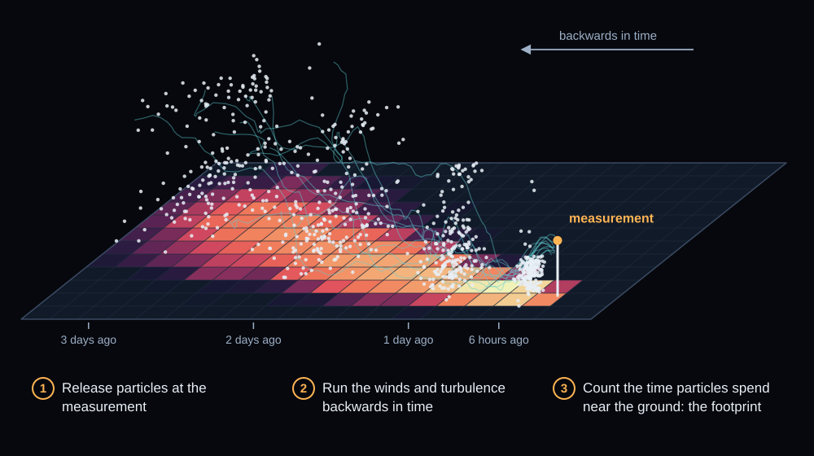
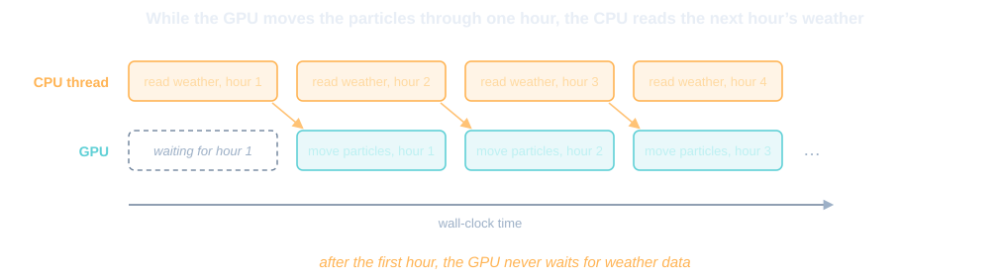
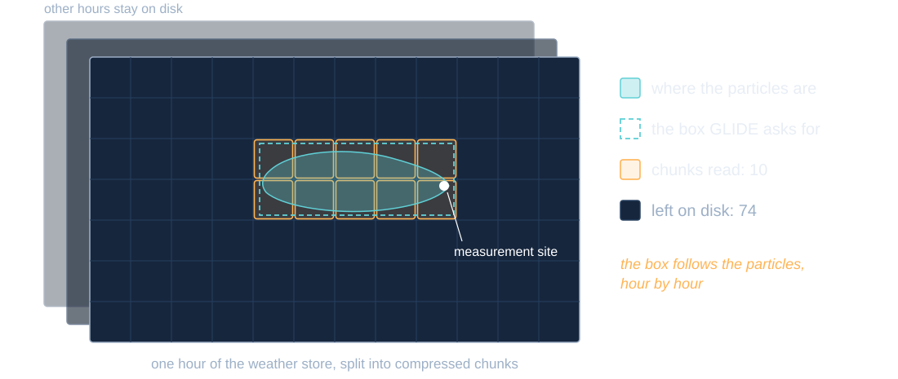
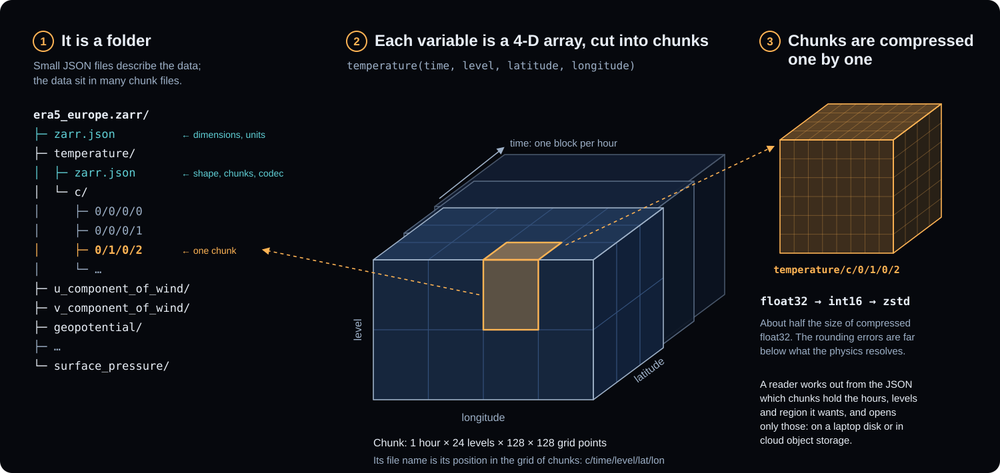
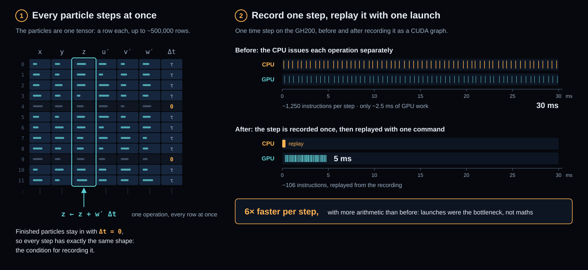
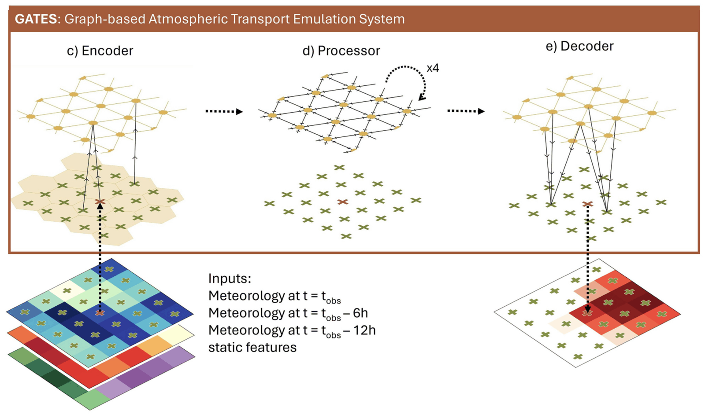

## What is a footprint?

::: {.compact}
- A backward-running Lagrangian model makes **one run per measurement**, and
  shows which surface fluxes that measurement can see
- The footprint is built up from **thousands of particles**, each following its
  own random path through the wind and turbulence
:::

{fig-alt="Particles released at a measurement tower are run backwards in time; the time they spend near the ground is counted on a grid to make the footprint" width="58%" fig-align="center"}

## Motivation for GLIDE

Every emissions estimate needs a **footprint** for every measurement.

We need far more of them, far faster:

1. **Satellites** bring *millions* of measurements, and NAME takes about
   **10 minutes per footprint**
2. **Machine-learning emulators** like our GATES (Fillola et al. (2026), *GMD*)
   learn footprints from a transport model, so they need **large, varied
   training sets**

::: {.card}
And an experiment: could AI coding agents build a research model?
Not one line of GLIDE was written by hand.
:::

::: {.muted .small .ref-bottom}
GATES: Fillola et al. (2026), *GMD* 19, 1893,
[doi:10.5194/gmd-19-1893-2026](https://doi.org/10.5194/gmd-19-1893-2026)
:::

## Architecture 1: pure PyTorch

::: {.compact}
- **One code** for NVIDIA GPUs, Apple laptops and CPUs
- Each time step is recorded as a **CUDA graph** and replayed with one
  command, so the GPU isn't kept waiting on the CPU
- **Batching** many nearby releases (sites and hours) keeps hundreds of
  thousands of particles stepping together, sharing the same meteorology
- The CPU reads the next hour's met. while the GPU works, **hiding most of
  the I/O cost**
:::

{fig-alt="The GLIDE pipeline, and the CPU reading the next hour of weather while the GPU integrates the current one" width="66%" fig-align="center"}

## Architecture 2: read only the meteorology it needs

{fig-alt="One hour of the weather store split into chunks; only the chunks under the particles' box are read" width="50%" fig-align="center"}

- NAME and FLEXPART read **every field over the whole domain** at each met time
- GLIDE asks for **one hour, over the box that holds the particles**, and only
  the chunks under it are read
- [**met-bazarr**](https://github.com/mrghg/met-bazarr), a separate tool,
  turns met data into those stores (ERA5, Met Office UM, etc.)

## What is a Zarr store?

{fig-alt="A meteorology Zarr store: a folder of JSON metadata and chunk files; each variable is a 4-D array of time, level, latitude and longitude cut into chunks of one hour, 24 levels and 128 by 128 grid points; each chunk is compressed on its own" width="100%" fig-align="center"}

## What it can do now

:::: {.columns}

::: {.column width="58%"}
<video data-autoplay loop muted playsinline src="img/footprints-model-levels-20s.mp4" width="100%"></video>
:::

::: {.column .compact width="42%"}
[0.38 s]{.stat}

[per footprint, on one GPU node]{.stat-label}

- Hourly footprints for the **ICOS network**: 56 sites, all of January 2024
- Turbulence and convection schemes that follow **FLEXPART**'s
- 319 automated tests

::: {.muted .small}
NAME: about 10 minutes per footprint. A sense of scale, not a benchmark.
:::

::: {.card}
**Fast is not the same as right.** The physics is not yet validated.
:::
:::

::::

## The validation plan (ongoing)

- **Agents wrote the code, so I can't vouch for it line by line.** The
  evidence has to.
- **It is easy to tune a model until it agrees**, and an agent will happily do
  that for you.
- **Footprint errors are silent.** They become errors in national emissions
  estimates.

::: {.card}
So GLIDE is judged by tests whose rules are fixed **before** any result exists.
:::

## The validation plan (ongoing)

```{=html}
<table class="ladder">
<colgroup><col style="width: 8%"><col style="width: 42%"><col style="width: 50%"></colgroup>
<thead><tr><th>Tier</th><th>Question</th><th>Tested against</th></tr></thead>
<tbody>
<tr><td>0</td><td>Does the code solve its equations?</td><td>exact mathematical solutions</td></tr>
<tr class="freeze"><td colspan="3"><span class="freeze-mark">▼</span> <strong>Physics freeze</strong> (tagged in git) + <strong>OSF pre-registration</strong>. Everything below runs on the frozen model.</td></tr>
<tr><td>1</td><td>Do shared components match FLEXPART?</td><td>FLEXPART’s own turbulence and convection routines</td></tr>
<tr><td>2</td><td>Does it move air like established models?</td><td><strong>FLEXPART</strong> and <strong>NAME</strong> on the same meteorology</td></tr>
<tr><td>3</td><td>Does it match the real atmosphere?</td><td>tracer releases: <strong>ETEX</strong>, <strong>CAPTEX</strong>, <strong>ANATEX</strong>; radon-222</td></tr>
<tr class="freeze"><td colspan="3"><span class="freeze-mark">▼</span> <strong>v1.0 release</strong> once Tiers 1–3 pass their pre-registered thresholds</td></tr>
<tr><td>4</td><td>Does it change an emissions estimate?</td><td>a UK methane inversion (the v1 paper)</td></tr>
<tr class="after"><td colspan="3"><span class="freeze-mark">▶</span> <strong>After v1:</strong> more experimental features: footprint derivatives, tracer calibration, GATES training sets</td></tr>
</tbody>
</table>
```

::: {.card}
**Fixed in the pre-registration:** model version, cases, metrics and pass/fail
thresholds for every tier. v1 uses published FLEXPART defaults; later
calibration fits only tracer data, never another model.
:::

## Thank you {.center background-video="img/footprints-model-levels-20s.mp4" background-video-loop="true" background-video-muted="true" background-opacity="0.28"}

::: {.repo}
[github.com/mrghg/glide](https://github.com/mrghg/glide)
[the model]{.what}

[github.com/mrghg/met-bazarr](https://github.com/mrghg/met-bazarr)
[weather data as Zarr]{.what}

[doi.org/10.5194/gmd-19-1893-2026](https://doi.org/10.5194/gmd-19-1893-2026)
[the GATES emulator]{.what}
:::

::: {.muted .small}
Not production-ready yet: validation is under way, following
[docs/validation-plan.md](https://github.com/mrghg/glide/blob/main/docs/validation-plan.md)
:::

## Extra: maximising GPU utilisation {visibility="uncounted"}

{fig-alt="Left: the particles as a tensor with one row per particle; one operation updates the z column of every row at once, and finished particles stay in with a zero timestep. Right: one time step before and after recording it as a CUDA graph; before, about 1,250 separate instructions over 30 ms with the GPU mostly idle; after, one replay and 5 ms" width="100%" fig-align="center"}

## Extra: training data for ML emulators (GATES) {visibility="uncounted"}

:::: {.columns}

::: {.column width="52%"}
{fig-alt="Figure from the GATES paper"}

::: {.caption}
GATES: Fillola et al., *GMD* 19, 1893 (2026),
[doi:10.5194/gmd-19-1893-2026](https://doi.org/10.5194/gmd-19-1893-2026)
:::
:::

::: {.column width="48%"}
- **GATES** is a graph neural network that emulates Lagrangian footprints
- Today it learns from **NAME** footprints, which are slow to make
- **GLIDE** can make training sets at a scale CPU models can't: new regions,
  new satellites, ensembles
- Both are built on **PyTorch**
:::

::::
