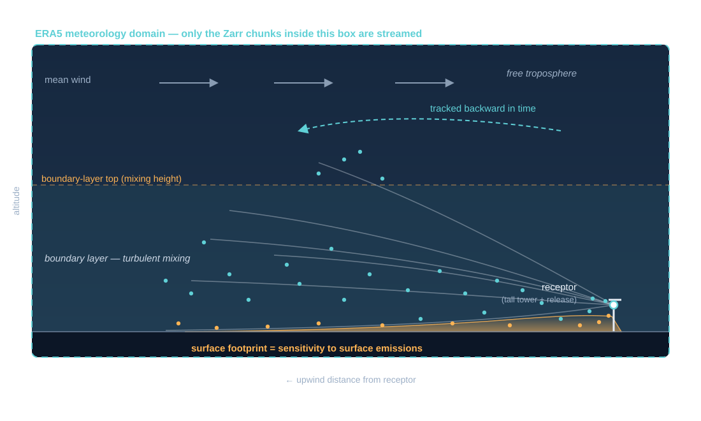
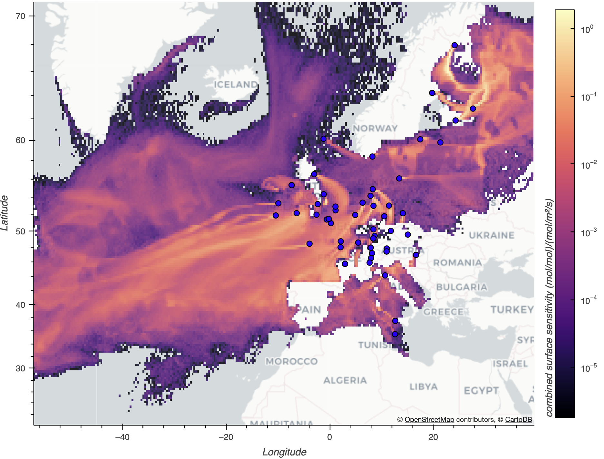
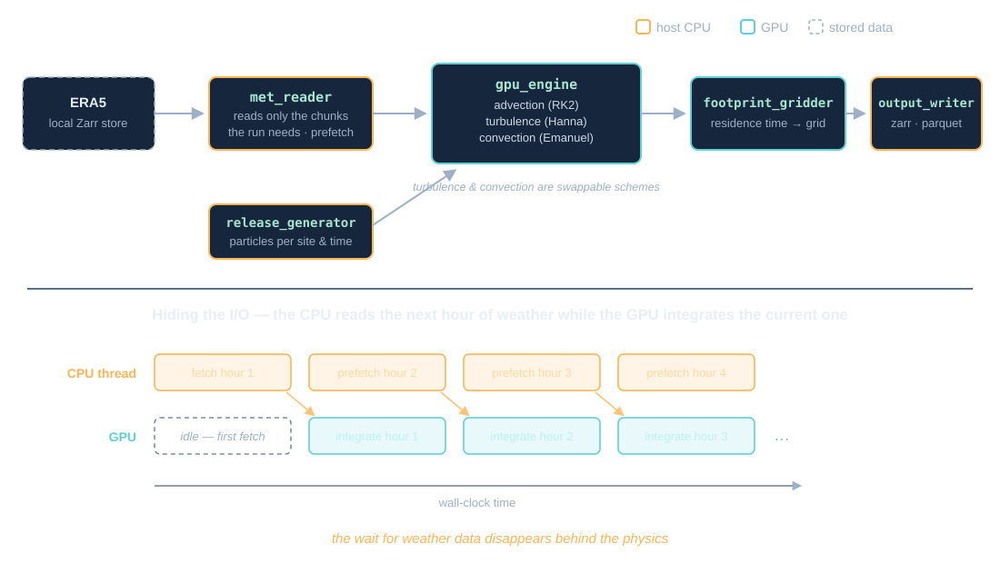

## What it is

**Backward Lagrangian particle dispersion** for greenhouse-gas **footprints**.

**Pure PyTorch — GPU-native, device-agnostic.**

::: {.muted}
A footprint links a measurement to the surface fluxes upwind of it — the
sensitivity behind every atmospheric emissions estimate.
:::

> **Research code — physics not yet fully validated. Not for production.**

---

## How a backward LPDM works {.smaller}

{width="90%" fig-align="center"}

---

## The question {.center}

::: {.card}
::: {.card-title}
Can a backward LPDM be *scalable* **and** *flexible*?
:::
:::

By rethinking its two classic bottlenecks:

- **I/O** — reading whole NetCDF / GRIB files
- **CPU physics** — single-threaded stepping

---

## Two bets

::: {.columns}
::: {.column width="50%"}
::: {.card}
::: {.card-title}
1 · Stream, don't read
:::
**ERA5** as chunked **Zarr**, stored locally — read only the pieces a run touches.

Per-window cache + background prefetch.
:::
:::
::: {.column width="50%"}
::: {.card}
::: {.card-title}
2 · Physics on the GPU
:::
`grid_sample` winds + Ornstein–Uhlenbeck turbulence.

**CUDA / MPS / CPU** · per-step **CUDA-graph** capture.
:::
:::
:::

---

## Built by vibe-coding {.smaller}

**Not one line of code written by hand.** [My job: direction, scepticism, and running the experiments.]{.muted}

| | Model | Contribution |
|---|---|---|
| April | Gemini 3 Pro | literature review (chat session) |
| April | GPT 5.5 | review + key papers → agent instructions + `CHECKPOINT.md`, the planning document ever since |
| Apr–Jun | Claude Sonnet | the bulk of the build — but missed the performance bottlenecks |
| Jun–Jul | Claude Opus 4.7 / 4.8 | the profiling & GPU optimisation that actually moved the needle |
| July | Claude Fable | thorough physics audit → several real bugs found & fixed |
| Aug–Nov | Claude, then Claude Fable 5.2 | roadmap, validation plan and agent task queue; the plan was reviewed and tightened by the newer model |

: {tbl-colwidths="[11,27,62]"}

::: {.card}
**April → November:** the capability jump between model generations was plainly
visible — later models caught bottlenecks and bugs that earlier ones missed.
:::

> Still to earn: a physics test suite robust enough to **convince me** it's right — work in progress.

[(so were these slides)]{.muted}

---

## What worked, what to watch {.smaller}

::: {.columns}
::: {.column width="50%"}
::: {.card}
::: {.card-title}
Upsides
:::
- **~20 h of my time · ~£18 of tokens** — against **person-months** of engineering effort
- The code is **genuinely well written**: clean, tested, documented
:::
:::
::: {.column width="50%"}
::: {.card}
::: {.card-title}
Caveats
:::
- Well written ≠ **readable to a scientist**
- **Confirmation bias** — it likes to butter you up
- **Context drift** · over-weights the odd stray prompt
- **"Token anxiety"** — and it's **addictive**
:::
:::
:::

::: {.card .card-amber}
::: {.card-title}
Bigger picture
:::
**Sensitive data** — what leaves the building? · **IT security** · **Energy use** · **Fairness** — who gets access to the best models?
:::

*Needs a strong dose of scepticism — but arguably no more than any human collaborator.*

---

## 2,688 footprints · ~25 minutes

{fig-align="center"}

**48 hours × 56 ICOS tall-tower sites** — 5-day backward footprints, one run on a single NVIDIA GH200 node.

At **~10 min per simulation** (NAME, ~4 CPU cores) the same 2,688 footprints would take **~19 days back-to-back** → **~1,000×** [ — different model & met: a scale comparison, not a benchmark]{.muted}

---

## The shape of the problem

- One footprint = **hundreds of thousands of particles** taking **thousands of tiny steps**
- Each step depends on the last → the steps **must run in order**
- Every particle does **identical maths** → a GPU can do them **all at once**
- Every release is **independent** → fan out across GPUs and nodes

::: {.card}
**Narrow and deep:** plenty of parallel work in each step, but thousands of small
steps in a row — and each one pays a fixed cost just to *ask* the GPU to work.
That asking, not the maths, sets the pace.
:::

---

## Architecture

{fig-align="center"}

---

## The physics

- **Turbulence** — Hanna (1982) boundary-layer + free-troposphere closure
- **Convection** — reduced Emanuel mass-flux (once per met window)
- **Well-mixed drift** (Thomson 1987), sign-flipped for backward Langevin:

$$\tfrac12\!\left(1+\frac{w'^2}{\sigma_w^2}\right)\frac{\partial \sigma_w^2}{\partial z}$$

::: {.muted}
FLEXPART-comparable — but reimplemented independently from the literature, and
kept as unit-tested free functions.
:::

---

## Making it fast

- Out of the box the GPU was only **~17 % busy** — the CPU was dictating the
  physics **one instruction at a time** (~1,250 kernel launches per step)
- The fix: record the whole step once → replay it as **one CUDA graph**, with
  **no CPU in the loop**
- The price: every step must be **identical** — fixed shapes, no branching.
  *That* was most of the engineering.

::: {.card}
**30 → 5 ms per step · same GPU · 6×** — a month of hourly footprints went
**~2.5 h → ~25 min**.
:::

---

## Where it stands {.smaller}

::: {.columns}
::: {.column width="50%"}
### Done & tested
- Core backward LPDM (advection + Langevin)
- Hanna turbulence (aligned to FLEXPART v11) · Emanuel convection
- Terrain-following vertical coordinate
- Multi-site simultaneous releases
- Streaming Zarr / Parquet output
- CUDA-graph GPU path
- 319 tests passing · 90 % coverage
:::
::: {.column width="50%"}
### In progress
- **Validation plan written** — pass marks agreed; reference runs being set up
- FLEXPART and NAME reference runs: **4,704 footprints** in January and July 2019
- Physics audits (July, August) → fixes landed; external sign-off still to come
- Native model-level met — plumbing done, not yet validated
:::
:::

> **Not yet validated** — treat results as indicative, not verified.

---

## The validation ladder {.big-table}

| Tier | Question | Tested against |
|:-|:-----------|:-----------|
| 0 | Does the code solve its equations? | exact mathematical solutions |
| 1 | Is each component right? | FLEXPART's own compiled routines |
| 2 | Does it move air like established models? | **FLEXPART** and **NAME**, 4,704 footprints |
| 3 | Does it match the real atmosphere? | ETEX, CAPTEX and ANATEX tracer releases |
| 4 | Does it change an emissions estimate? | a UK methane inversion |

: {tbl-colwidths="[8,46,46]"}

::: {.card}
**The pass mark for Tier 2:** as close to FLEXPART and NAME as they are to each other.
:::

> Cases, metrics and pass marks are **publicly registered before any result exists**.

---

## Roadmap {.smaller}

**v1 — a validated, reproducible LPDM**

- Efficiency changes that alter numerics → **physics freeze** → **validation**
- Met Office global analyses as a second meteorology, for a like-for-like test against NAME
- Column (tower, aircraft) and satellite-style releases
- Packaging: pip install, container, DOI

**Beyond v1**

- **Global domain** — follow every particle for a fixed time and record where it ends
- **Transport uncertainty** — in-batch ensembles, differentiable (tangent) footprints
- **Meteorology** — compressed stores, nesting, ML weather models
- **Scale** — satellite inversions, co-developed with the **GATES** GNN footprint emulator

---

## {.center}

<video class="anim-video" data-autoplay loop muted playsinline src="img/footprints-terrain-small.mp4"></video>

::: {.muted}
January 2024 · hourly · terrain-following coordinate · work in progress, feedback welcome — README · `docs/` · Apache-2.0
:::
